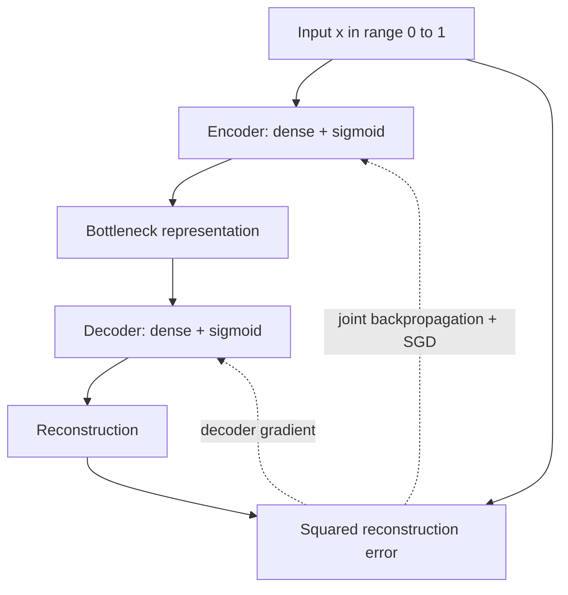

# Autoencoder

## Computation diagram



The input itself supplies the training target. The bottleneck compresses the representation; encoder and decoder have independent learned weights.

## How it works

An autoencoder learns to reconstruct its input through a smaller internal representation. The target is the input itself, so no separate class labels are needed:

```text
code = sigmoid(W_encoder input + b_encoder)
reconstruction = sigmoid(W_decoder code + b_decoder)
loss = ½ Σ_i (reconstruction_i - input_i)²
```

A bottleneck prevents a direct per-feature identity mapping. This model requires `0 < latentSize < inputSize`; learning a useful representation still depends on the data and objective. A smaller vector of doubles is not automatically an efficient compressed file.

## How it was programmed

[Autoencoder.cs](../../src/NeuralNetworks/Autoencoder.cs) contains an encoder and an independently weighted decoder. `Encode(input)` returns a copied latent vector; `Predict(input)` returns reconstruction. The two-argument `TrainSample(input, learningRate)` uses the input as its target. The inherited three-argument overload also permits an explicit target, for example a clean vector paired with a noisy input, but denoising is not separately evaluated here.

The [shared tape](../TRAINING.md) trains both blocks jointly. Weights are not tied. Inputs should be normalized to `[0, 1]` for reconstruction training, because sigmoid outputs and targets are bounded. Encoding and inference accept finite vectors, but inputs outside this range cannot be reconstructed faithfully with a bounded output.

## How to use it

```csharp
using NeuralNetworks;

var model = new Autoencoder(inputSize: 2, latentSize: 1, seed: 42);
double[][] samples = [[0, 1], [1, 0]];
for (var epoch = 0; epoch < 1200; epoch++)
    foreach (var sample in samples)
        model.TrainSample(sample, learningRate: 0.5);
var code = model.Encode([0, 1]);
var reconstruction = model.Predict([0, 1]);
```

Run `dotnet run --project examples/Architectures -- autoencoder`. It prints reconstructions and latent values for the two patterns. The validated mean reconstruction loss falls from about `0.280830` to `0.002838`.

## Validation and limitations

Tests check known encoding/decoding values, every encoder/decoder gradient, a genuine reconstruction task, deterministic isolation and invalid bottlenecks/inputs/targets. There is one sigmoid encoding layer and one sigmoid decoding layer, with no variational distribution, convolutional encoder, sparse penalty, tied weights or standalone decode API.

The tiny training example does not establish anomaly detection, denoising, useful compression or generalization. Those require appropriate objectives and separate evaluation datasets.

Further reading: [Reducing the Dimensionality of Data with Neural Networks](https://doi.org/10.1126/science.1127647). This project demonstrates a shallow bottleneck, not the paper's full deep training procedure.

Next: [RBF](rbf.md) · [all architecture guides](../README.md).
