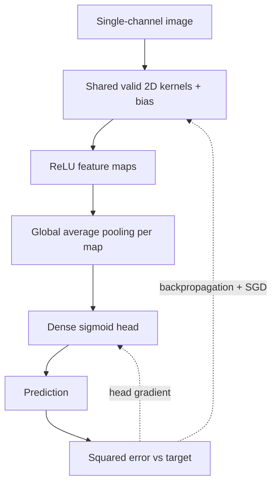

# Convolutional neural network (CNN)

## Computation diagram



One kernel is reused across spatial locations. Pooling reduces each map to one scalar; gradients from all locations accumulate into the shared kernel.

## How it works

A CNN reuses the same kernel at many positions, so it can learn local spatial features without a separate parameter for every pixel position. This model computes valid 2D **cross-correlation** (the usual operation called convolution in neural networks), applies ReLU, averages each feature map and predicts through a sigmoid head:

```text
feature_f(row, col) = ReLU(b_f + Σ_yx kernel_f(y, x) × image(row+y, col+x))
pooled_f = mean of feature_f over all valid locations
prediction = sigmoid(outputWeights × pooled + outputBias)
```

There is no kernel reversal, padding or stride setting; the stride is one. Global average pooling converts each feature map to one scalar.

## How it was programmed

[ConvolutionalNetwork.cs](../../src/NeuralNetworks/ConvolutionalNetwork.cs) extracts row-major patches and calls the same `LinearBlock` for every location. Reusing parameter nodes makes the [tape](../TRAINING.md) accumulate all spatial gradient contributions into shared kernels. Every filter has `kernelSize²` weights and one bias. ReLU's derivative at zero is defined as zero.

For image dimensions `width × height`, an input is a flat row-major array of length `width * height`; pixel `(row, col)` is `input[row * width + col]`. Feature maps have dimensions `(height-kernelSize+1) × (width-kernelSize+1)`. The output has `outputSize` independent sigmoid values.

## How to use it

```csharp
using NeuralNetworks;

var model = new ConvolutionalNetwork(width: 2, height: 2, kernelSize: 2,
    filters: 2, outputSize: 1, seed: 42);
double[][] images = [[-1, -1, -1, -1], [1, 1, 1, 1]];
double[][] targets = [[0], [1]];
for (var epoch = 0; epoch < 1200; epoch++)
    for (var i = 0; i < images.Length; i++)
        model.TrainSample(images[i], targets[i], learningRate: 0.5);
var bright = model.Predict([1, 1, 1, 1]);
```

Run `dotnet run --project examples/Architectures -- cnn`. It learns a tiny centered-intensity task and checks mean loss falls from about `0.097615` to `0.000266`. This does not demonstrate object recognition.

## Validation and limitations

Tests verify an independent known convolution/pooling result, inactive/active ReLU outputs, finite-difference gradients for every shared kernel/head parameter and actual training. Invalid image sizes, kernels, inputs and overflowing updates are rejected.

Only one input channel and one convolution stage are implemented. There are no color channels, max pooling, padding, configurable strides or deep feature hierarchies. Global average pooling discards location information. ReLU units can become inactive: a zero-versus-positive example with the original seed had all inactive filters and did not learn. The runnable example uses centered inputs, and learning remains dependent on inputs, seed and hyperparameters.

Further reading: [Gradient Based Learning Applied to Document Recognition](https://bottou.org/papers/lecun-98h). This implementation is a much smaller teaching model, not LeNet.

Next: [RNN](rnn.md) · [all architecture guides](../README.md).
