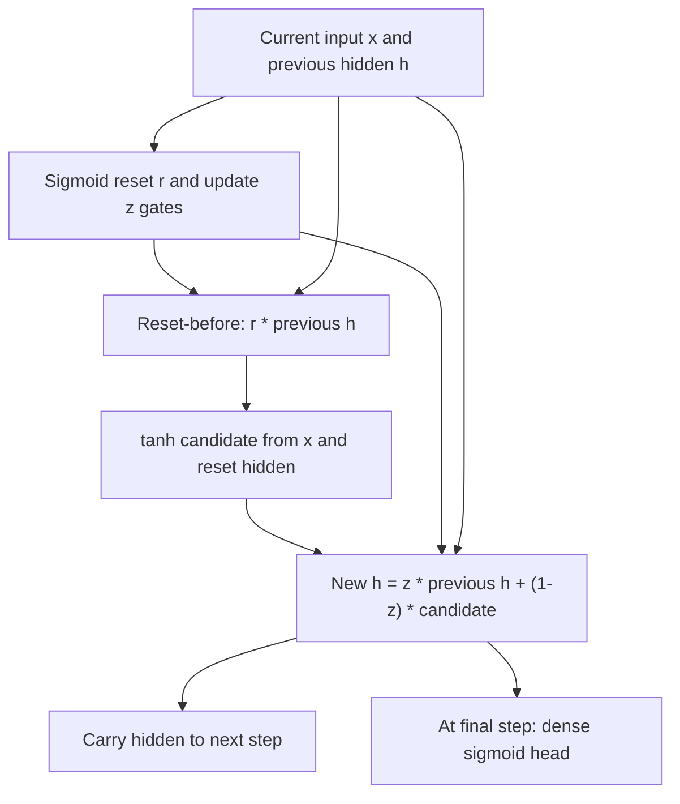

# Gated recurrent unit (GRU)

## Computation diagram



This implementation uses reset-before and weights the old hidden state by z. One hidden state is carried across the sequence; there is no separate cell state. All cells share weights and each call resets the state.

## How it works

A GRU combines recurrent memory with two gates and a single hidden state. This implementation uses the **reset-before** convention:

```text
u_t = [x_t, h_(t-1)]
z_t = sigmoid(W_z u_t + b_z)                  update gate
r_t = sigmoid(W_r u_t + b_r)                  reset gate
g_t = tanh(W_g [x_t, r_t × h_(t-1)] + b_g)    candidate
h_t = z_t × h_(t-1) + (1-z_t) × g_t
y   = sigmoid(W_head h_T + b_head)
```

Here a high update gate retains more old state. Other libraries may reverse the update convention or apply reset after the hidden projection; their parameter vectors cannot be assumed compatible with this model.

## How it was programmed

[GruNetwork.cs](../../src/NeuralNetworks/GruNetwork.cs) applies update/reset blocks to the concatenated input/old hidden state, multiplies the old state by reset values, then applies the candidate block. [SequenceNetwork.cs](../../src/NeuralNetworks/SequenceNetwork.cs) owns time iteration and the output head. The [tape](../TRAINING.md) differentiates the full sequence, including gate products and parameter sharing.

There is no separate cell state. Hidden state starts at zero for every sample. Input arrays are time-major and contain exactly `sequenceLength * inputSize` finite values; targets contain `outputSize` values in `[0, 1]`.

## How to use it

```csharp
using NeuralNetworks;

var model = new GruNetwork(sequenceLength: 3, inputSize: 1,
    hiddenSize: 3, outputSize: 1, seed: 42);
double[][] sequences = [[0, 0, 0], [1, 0, 0]];
double[][] targets = [[0], [1]];
for (var epoch = 0; epoch < 1200; epoch++)
    for (var i = 0; i < sequences.Length; i++)
        model.TrainSample(sequences[i], targets[i], 0.5);
var output = model.Predict([1, 0, 0]);
```

Run `dotnet run --project examples/Architectures -- gru`. It learns the same first-feature memory task as RNN and LSTM. A validated run reduced mean loss from about `0.126166` to `0.000181`.

## Validation and limitations

Tests independently calculate a two-step gated recurrence, compare every gradient to finite differences, check state reset and ownership, reject invalid/overflowing calls and verify actual learning.

This is a single-layer, sequence-to-vector GRU with reset-before equations. It does not expose stateful streaming, bidirectionality, variable sequence lengths, padding masks, clipping or alternative GRU conventions. No conclusion about superiority to RNN/LSTM follows from this two-sample task.

Further reading: [Learning Phrase Representations using RNN Encoder–Decoder for Statistical Machine Translation](https://arxiv.org/abs/1406.1078).

Next: [Transformer encoder](transformer.md) · [all architecture guides](../README.md).
