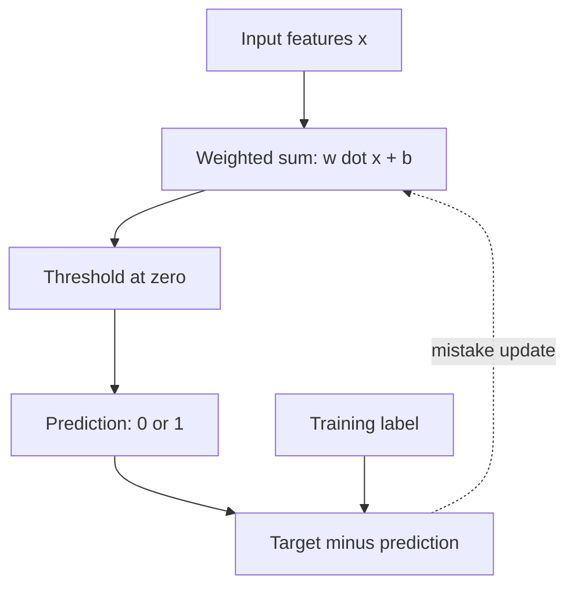

# Perceptron

## Computation diagram



Solid arrows show prediction and error calculation. The dotted arrow changes weights and bias only when the label disagrees with the prediction.

## How it works

A perceptron learns one linear binary decision boundary. It computes `score = w·x + b` and predicts 1 when `score >= 0`, otherwise 0. It has no hidden layer or differentiable output. For target `t` and prediction `y`, the mistake update is:

```text
error = t - y
w_i ← w_i + learningRate × error × x_i
b   ← b   + learningRate × error
```

Correct predictions leave weights unchanged. AND is linearly separable and is a suitable first example; XOR requires a nonlinear model such as the [MLP](mlp.md).

## How it was programmed

[Perceptron.cs](../../src/NeuralNetworks/Perceptron.cs) starts with zero weights and bias. `Predict` validates a finite vector and computes the score with explicit loops. `TrainSample` returns the pre-update error (`-1`, `0` or `1`), calculates a complete candidate parameter vector, and commits it after finite checks. `GetParameters`/`SetParameters` copy `[w0, w1, …, bias]`.

## How to use it

```csharp
using NeuralNetworks;

var model = new Perceptron(inputSize: 2);
double[][] x = [[0, 0], [0, 1], [1, 0], [1, 1]];
int[] target = [0, 0, 0, 1];
for (var epoch = 0; epoch < 20; epoch++)
    for (var i = 0; i < x.Length; i++)
        model.TrainSample(x[i], target[i], learningRate: 0.1);
int result = model.Predict([1, 1]); // 1
```

Run `dotnet run --project examples/Architectures -- perceptron` from the repository root. It verifies all four AND outputs exactly. Inputs must match `InputSize`; labels must be integer 0 or 1; rates must be finite and positive.

## Validation and limitations

Tests check AND learning, known decision scores, invalid labels/dimensions/values and unchanged parameters after rejected updates. This is binary linear classification only: no probabilities, multiclass head, backpropagation or convergence on nonseparable data. The caller chooses the iteration limit and training order.

Next: [MLP](mlp.md) · [all architecture guides](../README.md).
