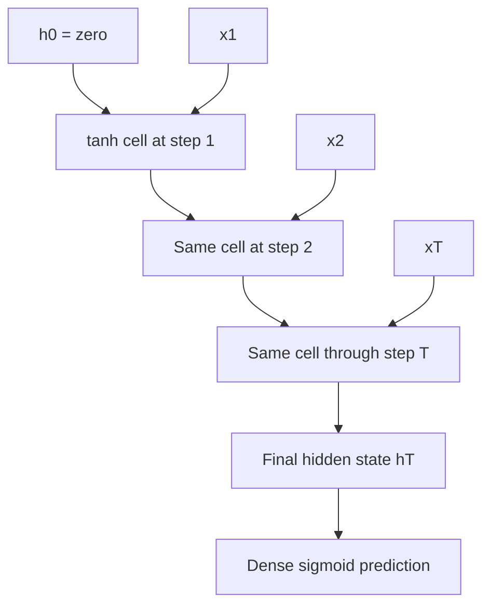

# Recurrent neural network (RNN)

## Computation diagram



The arrows between cells carry hidden state, while each step receives its own input. All cells share parameters; BPTT propagates final-output loss backward through the whole sequence. Each call starts from zero.

## How it works

A recurrent network carries a hidden state from one time step to the next. Sharing the same parameters at every step lets earlier observations affect the final prediction:

```text
h_0 = 0
h_t = tanh(W_x x_t + W_h h_(t-1) + b)
y = sigmoid(W_out h_T + b_out)
```

The loss is computed on `y`, the final output only. Backpropagation through time (BPTT) differentiates the full unrolled sequence, including every path through previous hidden states.

## How it was programmed

[RecurrentNetwork.cs](../../src/NeuralNetworks/RecurrentNetwork.cs) defines the tanh cell. [SequenceNetwork.cs](../../src/NeuralNetworks/SequenceNetwork.cs) handles zero-state initialization, time-step iteration and the common sigmoid output head. The cell takes `[currentFeatures, previousHidden]`, which implements `W_x` and `W_h` in one linear block. The [tape](../TRAINING.md) sums gradient contributions to reused weights across time.

Each call processes a fixed-length sequence and resets state. Flatten features in time-major order: `[step0_feature0, step0_feature1, …, step1_feature0, …]`. `InputSize = SequenceLength * Features`. There is no externally retained hidden state.

## How to use it

```csharp
using NeuralNetworks;

var model = new RecurrentNetwork(sequenceLength: 3, inputSize: 1,
    hiddenSize: 3, outputSize: 1, seed: 42);
double[][] sequences = [[0, 0, 0], [1, 0, 0]];
double[][] targets = [[0], [1]];
for (var epoch = 0; epoch < 1200; epoch++)
    for (var i = 0; i < sequences.Length; i++)
        model.TrainSample(sequences[i], targets[i], 0.5);
var remembered = model.Predict([1, 0, 0]);
```

Run `dotnet run --project examples/Architectures -- rnn`. It must remember the first feature after two zero-input steps. The validated seeded example lowers mean loss from about `0.127757` to `0.000069`.

## Validation and limitations

Tests check a known two-step recurrence by hand, every parameter gradient across multiple steps, repeatable state reset, boundaries and learning. Prediction and training do not modify caller arrays; rejected steps preserve parameters.

This is an Elman tanh, sequence-to-vector RNN. There are no variable lengths, masks, sequence-to-sequence outputs, streaming state, bidirectional layers or truncated BPTT. Long sequences may exhibit vanishing/exploding gradients and consume large tapes. There is no gradient clipping. The short synthetic memory task does not establish long-term memory performance.

Next: [LSTM](lstm.md) · [all architecture guides](../README.md).
