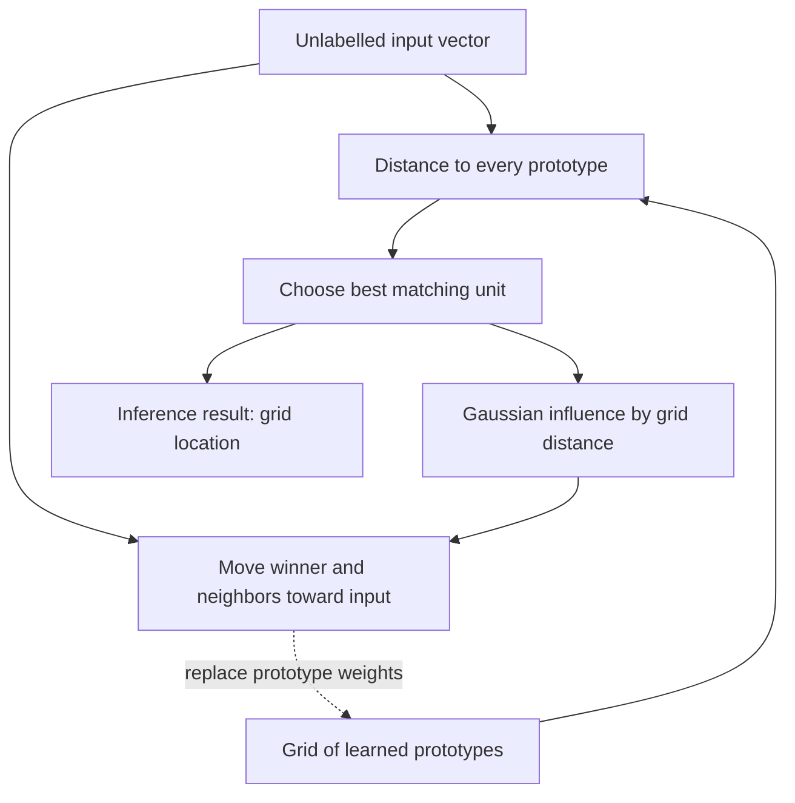

# Self-organizing map (SOM)

## Computation diagram



The grid supplies neighborhood distances; feature distances select the winner. Radius zero updates the winner alone. There are no class labels or backpropagation.

## How it works

A SOM learns prototype vectors arranged on a grid without target labels. For input `x`, the best matching unit (BMU) is the prototype with the smallest Euclidean distance. Its neighbors move toward the same input:

```text
winner = argmin_u Σ_i (x_i - weight_ui)²
influence_u = exp(-gridDistance(u, winner)² / (2 × radius²))
weight_ui ← (1 - rate × influence_u) weight_ui + rate × influence_u × x_i
```

Neighborhoods encourage nearby grid cells to represent similar inputs. A radius of zero is defined explicitly as winner-only learning. The caller normally decreases radius and rate over time.

## How it was programmed

[SelfOrganizingMap.cs](../../src/NeuralNetworks/SelfOrganizingMap.cs) initializes prototypes uniformly in `[0, 1)` with an instance-local seed. Winner search uses explicit squared-distance loops and chooses the first unit on ties. `TrainSample` computes Gaussian influence using rectangular grid coordinates, validates every candidate weight and swaps the complete array at the end.

Units are row-major: `column = unit % Width`, `row = unit / Width`. `GetWeights()` returns copied data ordered by unit, then feature. `TrainSample` returns the pre-update winner index; `FindBestMatchingUnit` evaluates without changing prototypes.

## How to use it

```csharp
using NeuralNetworks;

var model = new SelfOrganizingMap(width: 2, height: 2, inputSize: 2, seed: 42);
double[][] samples = [[0.1, 0.1], [0.9, 0.9]];
for (var epoch = 0; epoch < 200; epoch++)
{
    var progress = epoch / 199.0;
    foreach (var sample in samples)
        model.TrainSample(sample, learningRate: 0.5 * (1 - progress) + 0.05 * progress,
            radius: 1 - progress);
}
var unit = model.FindBestMatchingUnit([0.1, 0.1]);
```

Run `dotnet run --project examples/Architectures -- som`. It checks the reduction in mean squared quantization distance for two small clusters. This measures proximity to prototypes, not classification accuracy.

## Validation and limitations

Tests check seeded initialization, the exact winner/neighbor update, radius-zero behavior, copied snapshots and atomic rejection of invalid/overflowing input. Rates must be in `(0, 1]`, radii finite and nonnegative, and inputs finite with the specified feature count.

There are no labels, class probabilities, automatic learning schedules, toroidal grids or guarantees that a particular cluster will occupy a particular coordinate. Normalize features so Euclidean distance is meaningful. The map is useful for studying competitive learning, not evidence of general-purpose clustering performance.

Next: [CNN](cnn.md) · [all architecture guides](../README.md).
