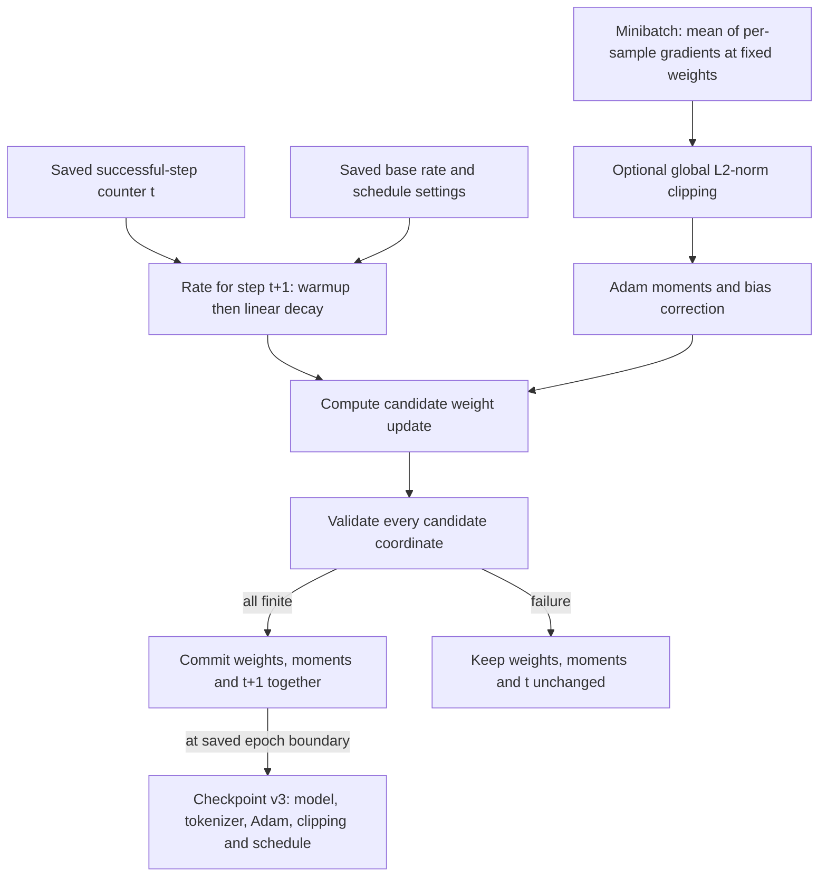

# Gradient clipping and learning-rate scheduling

## Computation diagram



Clipping acts on the **whole averaged parameter-gradient vector**, before Adam calculates either moment. The schedule selects the rate for an optimizer update, not for an epoch or individual sample. Rejected updates do not advance the schedule.

## What gradient clipping does

A very large gradient can destabilize optimization. Global norm clipping limits its L2 length while preserving its direction:

```text
norm = sqrt(sum_i gradient_i²)
clipped = gradient                         if norm <= maxNorm
clipped = gradient × (maxNorm / norm)       otherwise
```

For `[3, 4]` the norm is 5. With `maxNorm=2`, the result is `[1.2, 1.6]`. Clamping every coordinate independently would give a different direction and is not this algorithm. `MaxGradientNorm=null` disables clipping; a supplied threshold must be finite and positive. Zero gradients remain zero and output arrays are detached from inputs.

The implementation avoids forming an enormous squared norm. It finds `largest = max(abs(gradient_i))` and the norm of `gradient/largest`, compares against `maxNorm/scaledNorm`, then computes each clipped coordinate as `(gradient_i/largest) × (maxNorm/scaledNorm)`. This also avoids underflow of one tiny global scale factor multiplied by huge coordinates. Tests include finite coordinates near `double.MaxValue` and a very small threshold.

Clipping happens after averaging the samples in a minibatch. Clipping every sample first would define a different optimizer. It also happens **before** Adam's squared-gradient moment. It does not bound the final Adam parameter-update norm, repair a non-finite forward/backward computation or guarantee convergence. Thresholds must suit the task; extreme thresholds can still leave arithmetic outside the finite range.

## What the schedule does

`LinearWarmupDecay` uses a one-based update index `s = completedAdamSteps + 1`, base rate `base`, warmup steps `W >= 0`, decay length `D > 0` and minimum factor `0 < f <= 1`:

```text
if W > 0 and s <= W:
    factor = s / W
else:
    peakStep = max(1, W)
    progress = min((s - peakStep) / D, 1)
    factor = max(f, 1 - (1-f) × progress)
rate = base × factor
```

With warmup 2, decay 4, factor 0.2 and base 0.01, successive rates are:

```text
update index: 1      2     3      4      5      6      7...
rate:         .005   .010  .008   .006   .004   .002   .002...
```

The first warmup update has a small positive rate and update `W` reaches the base rate. Without warmup, update 1 uses the base rate. After `D` updates beyond that peak, the rate stays at `base × f`. The floor applies during/after decay, not during warmup. The final partial minibatch counts as one update. The schedule never extends itself because more epochs were requested.

`Schedule=null` keeps the original constant rate exactly. `GetNextLearningRate(baseRate)` inspects the next rate without changing state. Positive rates that underflow to zero during scaling throw before any update. The Adam step is already saved, so there is no second mutable scheduler counter that can drift out of sync. A rejected gradient, invalid rate, overflow or counter overflow preserves both optimization and schedule position.

## How it was programmed

- [GradientClipping.cs](../../src/NeuralNetworks/GradientClipping.cs) validates/copies a finite vector and implements stable global clipping.
- [LinearWarmupDecay.cs](../../src/NeuralNetworks/LinearWarmupDecay.cs) is an immutable schedule with validated settings and a pure rate calculation. Library step counts use signed 64-bit integers.
- [AdamOptimizer.cs](../../src/NeuralNetworks/AdamOptimizer.cs) adds optional `MaxGradientNorm` and `Schedule` to `AdamOptions`. `Step` obtains the next rate, clips if enabled, builds candidate moments/weights and commits the successful-step count with them. `StepCount` reads the completed-update count without copying moment arrays.
- [TextTraining.cs](../../src/NeuralNetworks/TextTraining.cs) still averages gradients at fixed minibatch weights and calls Adam once. Its rate argument is now explicitly the **base** rate when the optimizer has a schedule. Direct `TextTransformer.TrainSample` retains its per-sample SGD behavior.
- [TextCheckpoint.cs](../../src/NeuralNetworks/TextCheckpoint.cs) writes v3, requiring explicit clipping/schedule fields (possibly null) in Adam options. It reads v1 SGD and v2 constant-rate Adam without inventing enabled controls. It rejects missing/unknown fields, invalid thresholds/settings, malformed counters and incompatible states. See [the full schema](../CHECKPOINT_FORMAT.md).

## Run the complete example

From the repository root, with .NET 10:

```sh
dotnet run --project examples/CorpusTraining -- scheduled-demo
```

The example uses the same 20-record teaching corpus, two encoder/two decoder layers, two heads, width/FFN 16, seed 42 and batch size 4. Settings are base rate `0.003`, clip norm `1`, warmup `50`, decay `1450`, minimum factor `0.2`, and 300 epochs. There are five Adam updates per epoch. It saves/reloads at epoch 150 (step 750), resumes to step 1500, then verifies reloaded weights and generated IDs. Its default artifact is `artifacts/scheduled-corpus-demo.json` and can be regenerated; existing explicitly supplied custom artifact paths are refused.

A validated run produced:

```text
initial mean sample token CE=3.708338
step=0; next rate=0.00006
step=750; next rate=0.0018397241
step=1500; next rate=0.0006
final mean sample token CE=0.071187
matched prompt groups=17/17; distinct matching replies=16
```

These measurements describe memorization of the bundled corpus. The gate remains loss below one fifth of initial loss, at least 80% of prompt groups matching a known reply with EOS, and at least eight distinct replies. The demo is not a controlled comparison against constant-rate Adam or evidence of improved held-out accuracy. Custom shorter epoch counts may not meet its learning gate; the declared schedule settings stay fixed.

## Train, resume and generate

```sh
dotnet run --project examples/CorpusTraining -- train --corpus examples/CorpusTraining/Data/words.jsonl --checkpoint artifacts/controlled.json --optimizer adam --batch-size 4 --rate 0.003 --clip-norm 1 --schedule linear --warmup-steps 50 --decay-steps 1450 --min-rate-factor 0.2 --epochs 150
dotnet run --project examples/CorpusTraining -- resume --corpus examples/CorpusTraining/Data/words.jsonl --checkpoint artifacts/controlled.json --epochs 150
dotnet run --project examples/CorpusTraining -- generate --checkpoint artifacts/controlled.json --prompt "?" --sample --top-k 4 --seed 7
```

A new Adam run can enable clipping alone, a schedule alone, both, or neither. CLI `--schedule` defaults to `constant`; schedule parameters require `--schedule linear`. For the linear schedule defaults are warmup 0, decay 1000 and minimum factor 0.1. CLI counts accept 32-bit integers; library counters/settings support 64-bit integers. Adam controls with SGD are rejected. Existing corpus/UTF-8/capacity and overwrite checks still apply.

Resume restores thresholds, schedule, moments, counter, batch size, base rate, epoch and shuffle seed. CLI overrides for clipping/schedule/optimizer/batch settings are rejected so resume cannot silently restart a policy. `--rate` may explicitly change the **base** rate, thereby scaling all subsequent scheduled rates; this changes the trajectory. `--new-corpus` retains weights, moments, Adam step and schedule position while resetting epoch shuffle ordering. It does not restart warmup. The loaded vocabulary/capacities remain fixed.

Saving a completed epoch does not save an iterator inside a partial epoch. For exact same-runtime continuation, preserve corpus/order, batch size, epoch/shuffle seed, weights, moments, completed step, Adam options, clipping, schedule and base rate. A numerical failure in a later batch does not roll back earlier successful batches in RAM; the file remains the last saved completed epoch. Generation uses the model/tokenizer and does not advance Adam or the schedule.

## Library usage

```csharp
using NeuralNetworks;

var tokenizer = CharacterTokenizer.FromCorpus(["a", "b"]);
var model = new TextTransformer(tokenizer.VocabularySize, 2, 2, 4, 2, 4, 1, 1, seed: 42);
EncodedTextPair[] samples = [
    new(tokenizer.Encode("a", addEos: true), tokenizer.Encode("b", addEos: true)),
    new(tokenizer.Encode("b", addEos: true), tokenizer.Encode("a", addEos: true))
];
var optimizer = new AdamOptimizer(model, new AdamOptions(MaxGradientNorm: 1,
    Schedule: new LinearWarmupDecay(WarmupSteps: 2, DecaySteps: 8, MinimumFactor: 0.2)));
TextTraining.TrainEpoch(model, samples, optimizer, 2, 0.003, shuffleSeed: 42, epoch: 0);
var path = Path.Combine(Path.GetTempPath(), "controls-" + Guid.NewGuid().ToString("N") + ".json");
try
{
    // Use TextCorpus.Fingerprint in a file-backed run; this is a labelled fixture hash.
    var progress = new TextTrainingState(1, 42, 0.003, new string('a', 64), 2, "adam");
    TextCheckpoint.Save(path, model, tokenizer, progress, optimizer);
    var loaded = TextCheckpoint.Load(path);
    var nextRate = loaded.Optimizer!.GetNextLearningRate(loaded.Training!.LearningRate);
    TextTraining.TrainEpoch(loaded.Model, samples, loaded.Optimizer, loaded.Training.BatchSize,
        loaded.Training.LearningRate, loaded.Training.ShuffleSeed, loaded.Training.EpochsCompleted);
}
finally { if (File.Exists(path)) File.Delete(path); }
```

This minimal snippet exercises state roundtrip and continued training, not learned reply quality. Use the executable demo for the complete learning task.

## Validation and boundaries

Tests independently verify `[3,4]` clipping, unchanged/zero gradients, detached arrays, very large finite vectors, known schedule rates at warmup/decay/floor boundaries, clipped **batch-mean** updates versus independent gradients, and rejection without changing weights/moments/counter. Interrupted training crosses warmup and decay boundaries and matches uninterrupted parameters/state exactly. Malformed v3 controls are rejected even after recomputing their checksum; nonzero v2 Adam moments resume with their original constant-rate behavior.

Clipping cannot prevent every overflow earlier in a scalar tape. Warmup/decay is one policy, not automatic hyperparameter selection. There is no metric-based scheduler, cosine schedule, gradient scaling/accumulation across several minibatches, AdamW, GPU kernel or guaranteed learning-quality improvement. Use short contexts, modest dimensions and independent evaluation data for real quality claims.

[Minibatch Adam](transformer-minibatch-adam.md) · [checkpoint schema](../CHECKPOINT_FORMAT.md) · [all guides](../README.md).
