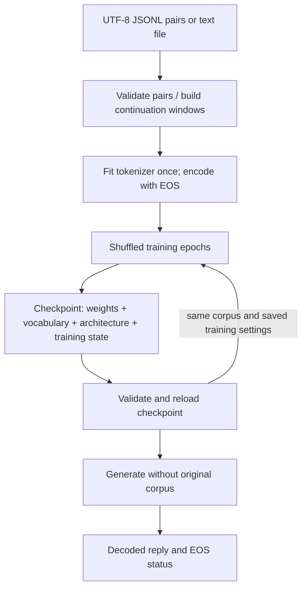

# Training from files, checkpoints and varied generation

## Computation diagram



For Adam, the checkpoint also contains moments and the step counter; the minibatch guide explains that update path. Resuming keeps the loaded vocabulary fixed. Checkpoint arrows represent saved snapshots, not a differentiable part of the network.

## What this adds

The token Transformer can now train from a local UTF-8 corpus, save its exact vocabulary/configuration/weights together, reload for inference without retraining, and resume SGD or minibatch Adam at an epoch boundary. Temperature/top-k sampling complements the existing deterministic greedy decoder.

This is a larger **teaching** example: the bundled JSONL corpus has 20 records, 17 distinct prompts and 16 distinct replies. It remains a small scalar implementation. File support does not turn it into an optimized large-language-model training system.

## How the corpus works

### Prompt/response JSONL

Each nonblank physical line is one strict JSON object with exactly two string fields:

```json
{"prompt":"s","response":"sol"}
{"prompt":"l","response":"lua"}
{"prompt":"?","response":"sol"}
{"prompt":"?","response":"lua"}
```

Fields preserve case, whitespace and Unicode. JSON escapes can represent embedded newlines. A prompt may be empty; a reply may be empty (it then trains EOS), but a pair cannot have both fields empty. Nulls, missing/unknown/duplicate fields, invalid UTF-8/UTF-16 and over-limit data are rejected. A UTF-8 BOM at the start of a corpus is accepted. Repeated prompts are allowed: multiple replies train a conditional distribution instead of a single lookup answer.

[The bundled corpus](../../examples/CorpusTraining/Data/words.jsonl) maps short labels to Portuguese words. `?` has four alternatives: `sol`, `lua`, `mar` and `céu`. The nonzero final loss partly reflects this deliberate ambiguity; the model cannot assign probability one to all four first characters simultaneously.

### Plain-text continuation windows

`TextCorpus.LoadText` treats an ordinary UTF-8 file as Unicode scalars. It normalizes line endings to LF and extracts complete sliding windows:

```text
text: abcdef...
promptLength=2, responseLength=2, stride=2
samples: ab -> cd, cd -> ef, ...
```

Both lengths and stride are positive. The incomplete tail is omitted. A sample limit is an error, not silent truncation. EOS is added to the end of each encoded continuation window, so it means **end of this training span**, not necessarily the end of a sentence or document. Increase response length for longer trained spans; generation still respects the model's target capacity.

Corpus loading is bounded and in-memory. Defaults are 8 MiB of UTF-8, 10,000 samples and 4,095 scalars per field. A field's EOS consumes one extra token. The limits are configurable, but computation grows with sequence length, layer width/depth and number of samples. Start with short windows.

## How it was programmed

- [TextCorpus.cs](../../src/NeuralNetworks/TextCorpus.cs) parses pairs/windows, validates Unicode/limits, exposes immutable text pairs, fits a tokenizer and produces caller-owned encoded arrays. Its fingerprint is SHA-256 of canonical parsed pairs **in order**, not the filename or raw JSON whitespace.
- [TextTraining.cs](../../src/NeuralNetworks/TextTraining.cs) validates/copies every sample before changing weights and shuffles indices with `Random(unchecked(shuffleSeed + epoch))`. It then applies the existing per-sample SGD. Its return value averages pre-update step losses; the CLI recomputes post-epoch loss for reporting.
- [TextCheckpoint.cs](../../src/NeuralNetworks/TextCheckpoint.cs) saves format version, complete architecture, exact ID vocabulary, double parameters and optional training progress in one JSON file with a payload checksum. It validates dimensions/counts/limits before allocating the model. [The format specification](../CHECKPOINT_FORMAT.md) explains the byte-level contract.
- [TextFiles.cs](../../src/NeuralNetworks/Internal/TextFiles.cs) centralizes bounded reads, duplicate-property validation and sibling-temp-file/rename replacement.
- [TextSamplingOptions.cs](../../src/NeuralNetworks/TextSamplingOptions.cs) excludes PAD/BOS, sorts eligible logits, keeps top-k and samples a stable temperature-scaled distribution. EOS and the length cap still control stopping.
- [The executable](../../examples/CorpusTraining/CorpusCommands.cs) provides `demo`, `train`, `resume` and `generate`; generation loads the checkpoint alone and does not need the original corpus.

## Quick start: saved model and varied output

From the repository root, with .NET 10 on PATH:

```sh
dotnet build --configuration Release
dotnet run --project examples/CorpusTraining --configuration Release --no-build -- demo
```

The default demo uses width 16, two heads, two encoder/two decoder layers, FFN width 16, seed 42, rate 0.02 and 500 shuffled epochs. It saves every 50 epochs to `artifacts/corpus-demo.json`, reloads, checks parameter equality and checks generation against the pre-save model. It overwrites its default demo artifact when repeated. An explicitly supplied existing custom checkpoint path is refused.

A validated run produced:

```text
Samples=20; vocabulary=26; source capacity=2; target capacity=7; parameters=10298
mean sample CE=3.708338 -> 0.072319
prompts=17; matched=17; distinct matched replies=16
s -> sol; EOS=True
l -> lua; EOS=True
c -> céu; EOS=True
sample '?' seed=7 -> sol; EOS=True
sample '?' seed=19 -> lua; EOS=True
Reload verified.
```

These are training-corpus measurements. The executable's declared gate is loss below one fifth of initial loss, at least 80% of distinct prompts producing a trained alternative with EOS, and at least eight distinct matching replies. Duplicate-prompt alternatives are evaluated as a set. It does not claim held-out generalization, and sampled strings may be wrong.

Generate later **without training again**:

```sh
dotnet run --project examples/CorpusTraining -- generate --checkpoint artifacts/corpus-demo.json --prompt s
dotnet run --project examples/CorpusTraining -- generate --checkpoint artifacts/corpus-demo.json --prompt "?" --sample --temperature 1 --top-k 4 --seed 7
dotnet run --project examples/CorpusTraining -- generate --checkpoint artifacts/corpus-demo.json --prompt "?" --sample --temperature 1 --top-k 4 --seed 19
```

A seed restarts a local sampling RNG on each call. Same weights/prefix/options/runtime reproduce a sample; different seeds can choose alternatives. Temperature must be finite and positive. Smaller temperatures sharpen choices; larger ones flatten them and can increase errors. `top-k=0` uses all eligible IDs; positive k must not exceed vocabulary size minus PAD/BOS. `top-k=1` selects the best eligible logit, breaking ties by ID. Greedy decoding remains `Generate`, with no random sampling.

## Train your own file

```sh
dotnet run --project examples/CorpusTraining -- train --corpus examples/CorpusTraining/Data/words.jsonl --checkpoint artifacts/words.json --epochs 500 --model-size 16 --heads 2 --ff 16 --encoder-layers 2 --decoder-layers 2 --rate 0.02 --seed 42
```

Training fits the vocabulary once and infers source/target capacities from encoded samples including EOS. Existing output checkpoints are refused unless `--overwrite` is explicit. Checkpoints are written initially, every 50 completed epochs and after the requested final epoch. All fields must fit the configured limits; data is not silently shortened.

For a plain-text file:

```sh
dotnet run --project examples/CorpusTraining -- train --corpus examples/CorpusTraining/Data/continuations.txt --format text --prompt-length 4 --response-length 4 --stride 4 --checkpoint artifacts/continuations.json --epochs 50
dotnet run --project examples/CorpusTraining -- generate --checkpoint artifacts/continuations.json --prompt "O so" --sample --temperature 0.9 --top-k 4 --seed 7
```

This trains character-span continuation, not guaranteed complete sentences. Corpus limits can be adjusted with `--max-bytes`, `--max-samples` and `--max-field`. Loader limits and checkpoint limits are separate; models beyond the checkpoint defaults require the library's explicit `TextCheckpointLimits` when loading. The CLI uses those defaults.

## Resume and reproducibility

```sh
dotnet run --project examples/CorpusTraining -- resume --corpus examples/CorpusTraining/Data/words.jsonl --checkpoint artifacts/words.json --epochs 100
```

`--epochs` means **additional** epochs on resume. Architecture, tokenizer and capacities come from the artifact. Progress stores completed epoch count, shuffle seed, learning rate and corpus fingerprint. With the same sample order/content, runtime and settings, resuming at a saved epoch boundary matches uninterrupted SGD. That SGD path has no optimizer buffers; [the Adam path](transformer-minibatch-adam.md) restores moments and the step counter as well. A failure within an epoch can leave earlier steps applied in RAM; the file remains the last completed saved checkpoint, not a partial epoch.

Changed corpus fingerprints are rejected by default. `--new-corpus` explicitly retains weights and resets epoch ordering/progress for a new dataset. The tokenizer remains frozen: unknown corpus characters or over-capacity fields still fail. Fit a new model/vocabulary for new characters, or explicitly use the library's `Encode(..., allowUnknown: true)` if mapping them to UNK is intended. The CLI does not silently expand vocabulary or replace characters. Repeat the same text-window settings when resuming plain-text training.

## Library usage

```csharp
using NeuralNetworks;

var path = Path.Combine(Path.GetTempPath(), "corpus-example-" + Guid.NewGuid().ToString("N") + ".json");
var tokenizer = CharacterTokenizer.FromCorpus(["sol", "lua"]);
var model = new TextTransformer(tokenizer.VocabularySize, 4, 4, seed: 42);
model.TrainSample(tokenizer.Encode("sol", addEos: true), tokenizer.Encode("lua", addEos: true), 0.01);
try
{
    TextCheckpoint.Save(path, model, tokenizer);
    var loaded = TextCheckpoint.Load(path);
    var greedy = loaded.Model.Generate(loaded.Tokenizer.Encode("sol", addEos: true));
    var sampled = loaded.Model.Sample(loaded.Tokenizer.Encode("sol", addEos: true),
        new TextSamplingOptions(Temperature: 0.9, TopK: 3, Seed: 7));
    var text = loaded.Tokenizer.Decode(sampled.Tokens);
}
finally { if (File.Exists(path)) File.Delete(path); }
```

This snippet exercises file roundtrip and inference after one SGD step; it does not claim learned reply quality. Use the executable for the full validated training example. Always save the tokenizer used for training: equal vocabulary sizes cannot prove that a caller supplied the historically correct character mapping.

## Validation and limitations

Tests cover strict UTF-8/JSONL, Unicode windows, limits/unknown data, vocabulary restoration, exact double-bit roundtrip, identical parameters/predictions/loss/gradients/generation after loading, resumed epochs versus uninterrupted training, invalid late samples before any update, corrupt checksums, unknown schemas/fields, incompatible vocabulary/parameter counts, oversized architectures and sampling controls. CI runs the complete file-backed demo on Linux, macOS and Windows.

The default checkpoint loader limits are 32 MiB, one million parameters, 65,536 vocabulary IDs, 4,096 tokens per side and 64 layers per stack. Limits are checked before model construction. The SHA-256 checksum detects accidental corruption; it is not an authenticity signature. Save uses same-directory temporary output and rename, with failed temporary files cleaned up; filesystem/power-loss durability is not a backup strategy. Numerical models outside `TextTransformer` still have no standard checkpoint format.

The corpus is fully materialized under its limits, not streamed/sharded training. SGD and minibatch Adam are available, without batch/tensor acceleration, incremental vocabulary growth, KV cache or long-context language-model quality guarantee. A larger input file can require substantial CPU time in scalar loops. Use small dimensions/contexts, measure loss and generated outputs, and keep a separate evaluation corpus for any real generalization claims.

[Text Transformer](transformer-text.md) · [checkpoint format](../CHECKPOINT_FORMAT.md) · [all guides](../README.md).

[Minibatch Adam and optimizer checkpoints](transformer-minibatch-adam.md) extends the same corpus workflow with saved moments and batch settings.
