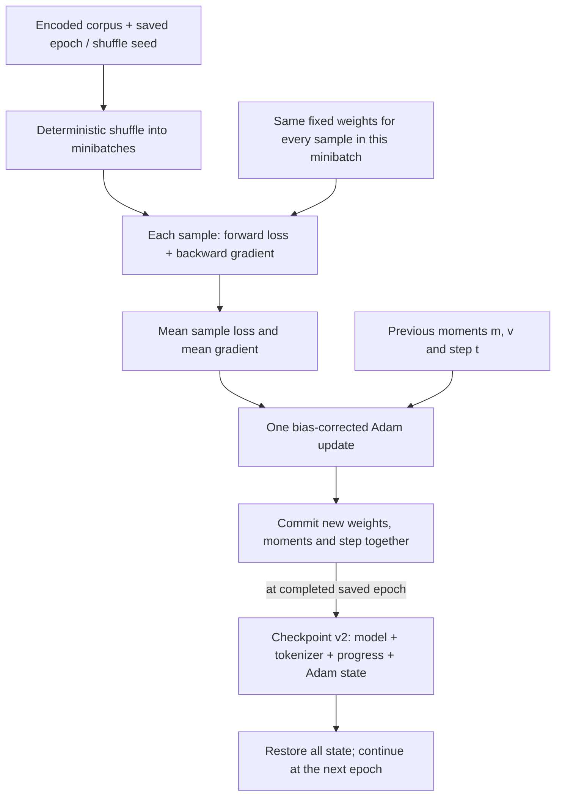

# Transformer minibatches, Adam and resumable optimizer state

## Computation diagram



Solid paths show a training step and saved-state flow. Every sample in a minibatch sees the same weights. Gradients are averaged before Adam changes the parameters. The checkpoint boundary is a completed epoch; it does not record an iterator into a partial epoch.

## Why use minibatches?

Per-sample SGD updates after every training pair. A minibatch collects several pairs, computes their gradients without intermediate updates and applies one optimizer step. This reduces update frequency and averages different sample directions. It changes the optimization trajectory; it is not equivalent to repeating `TrainSample` several times.

For a minibatch of `B` samples with reply lengths `T_s` (including EOS):

```text
sampleLoss_s = (1 / T_s) × sum of valid reply-token cross-entropies
batchLoss    = (1 / B) × sum_s sampleLoss_s
batchGradient = (1 / B) × sum_s gradient(sampleLoss_s)
```

Each **sample** has equal weight, even if reply lengths differ. Trailing PAD does not contribute; EOS does. This is not a mean over every token in the combined batch. A final batch smaller than the requested size uses its actual sample count; it is neither dropped nor padded with duplicate records. A batch larger than the corpus produces one update per epoch.

The implementation accumulates gradients serially with a fresh scalar tape per sample. This provides minibatch semantics without GPU/vectorized batch execution. Peak tape memory remains one sample, plus parameter/gradient/moment buffers and the materialized corpus. No padded tensor batch is allocated.

## How Adam works

Adam tracks an exponential first moment (a smoothed gradient) and second moment (a smoothed squared gradient) for each trainable parameter. Starting with `m = 0`, `v = 0`, `t = 0`, one **minibatch** advances:

```text
t     = t + 1
m     = beta1 × m + (1 - beta1) × gradient
v     = beta2 × v + (1 - beta2) × gradient²
mHat  = m / (1 - beta1^t)
vHat  = v / (1 - beta2^t)
weight = weight - learningRate × mHat / (sqrt(vHat) + epsilon)
```

All operations on vectors are elementwise. The correction counters the initial zero-moment bias. Epsilon is added **outside** the square root. Defaults are beta1 `0.9`, beta2 `0.999`, epsilon `1e-8`; beta values must be finite in `[0, 1)` and epsilon/rate finite and positive. This is ordinary Adam, without AdamW weight decay, AMSGrad, clipping or a scheduler.

Saving only weights loses `m`, `v` and `t`, so a newly constructed optimizer takes a different next step. A resumable checkpoint therefore saves all three plus Adam options and the training batch size. The step counter counts updates, not samples or epochs: 20 samples, batch size 4 and 300 epochs produce 1,500 steps.

## How it was programmed

- [TextTransformer.cs](../../src/NeuralNetworks/TextTransformer.cs) evaluates loss and gradient from one tape for a training sample, without updating parameters.
- [TextTraining.cs](../../src/NeuralNetworks/TextTraining.cs) exposes `TrainBatch(model, samples, optimizer, rate)` and an Adam `TrainEpoch` overload. It validates/copies every epoch sample before any batch update, shuffles indices using `Random(unchecked(shuffleSeed + epoch))`, processes complete/partial batches and returns a sample-weighted average of pre-update batch losses. The existing SGD overload remains available.
- [AdamOptimizer.cs](../../src/NeuralNetworks/AdamOptimizer.cs) binds one optimizer to one `ParameterizedModel` instance. `Step` computes candidate moments and weights, checks finite arithmetic and commits only after every coordinate succeeds. `GetState` and `Restore` copy arrays. Invalid state, malformed gradients, overflow or step-counter overflow leave weights and optimizer state unchanged for that step.
- [TextCheckpoint.cs](../../src/NeuralNetworks/TextCheckpoint.cs) now writes v2, including optional Adam state and batch metadata; it still reads v1 SGD files. Moment array lengths, finite values, nonnegative second moments, counters/options and optimizer/progress agreement are validated. It does not silently discard corrupt or missing Adam state.
- [CorpusCommands.cs](../../examples/CorpusTraining/CorpusCommands.cs) preserves SGD as the default, adds Adam configuration to `train`, restores it automatically in `resume` and supplies `adam-demo` with an actual midpoint save/reload.

A failed numerical update is transactional for **one batch**, not the entire epoch: earlier successful batches remain in RAM. The file stays at the last saved completed epoch. Instances and their inputs need external synchronization if used concurrently. Do not manually replace a model's weights and continue with unrelated old moments; create/restore the matching optimizer along with its weights.

## Run the complete example

From the repository root with .NET 10:

```sh
dotnet build --configuration Release
dotnet run --project examples/CorpusTraining --configuration Release --no-build -- adam-demo
```

The demo uses the original 20-pair corpus, width/FFN 16, two heads, two encoder and two decoder layers, seed 42, batch size 4, Adam defaults, rate `0.003` and 300 epochs. It saves/reloads at epoch 150 (step 750), resumes to epoch 300 (step 1,500) and verifies final pre/post-save weights and generated IDs. The default artifact is `artifacts/adam-corpus-demo.json`; repeated demo runs replace it. Existing explicitly supplied custom checkpoint paths are refused.

A local validated run reduced mean sample token CE from `3.708338` to `0.071503`, matched all 17 prompt groups with EOS and produced 16 distinct matching replies. The acceptance gate remains loss below one fifth of initial loss, at least 80% of prompt groups matching a trained alternative with EOS and at least eight distinct replies. These are corpus-memorization measurements, not held-out quality or a speed comparison with SGD. Different settings can fail to converge.

## Train, resume and generate

```sh
dotnet run --project examples/CorpusTraining -- train --corpus examples/CorpusTraining/Data/words.jsonl --checkpoint artifacts/my-adam.json --optimizer adam --batch-size 4 --rate 0.003 --beta1 0.9 --beta2 0.999 --epsilon 1e-8 --epochs 150
dotnet run --project examples/CorpusTraining -- resume --corpus examples/CorpusTraining/Data/words.jsonl --checkpoint artifacts/my-adam.json --epochs 150
dotnet run --project examples/CorpusTraining -- generate --checkpoint artifacts/my-adam.json --prompt "?" --sample --top-k 4 --seed 7
```

`--epochs` on resume means additional epochs. The CLI restores optimizer kind, batch size, beta values, epsilon, moments and step count. It rejects optimizer/batch/architecture overrides during resume; it never converts a saved Adam run into fresh SGD. Rate and shuffle seed may be explicitly changed, but then the trajectory differs from the original settings. `--new-corpus` retains weights **and Adam moments/step**, resets epoch ordering to zero and updates the fingerprint; loaded vocabulary/capacities remain fixed. It does not reset Adam's bias-correction counter.

New training refuses existing checkpoints unless `--overwrite` is explicit. `--optimizer sgd` remains per-sample (batch size 1); Adam-only settings or larger batches with SGD are rejected. Plain-text windows work with the same `--format text` options described in [the corpus guide](transformer-corpus-checkpoints.md). Generation needs only the saved file and does not train or require the corpus.

## Library usage

```csharp
using NeuralNetworks;

var tokenizer = CharacterTokenizer.FromCorpus(["a", "b"]);
var model = new TextTransformer(tokenizer.VocabularySize, 2, 2, modelSize: 4,
    headCount: 2, feedForwardSize: 4, encoderLayerCount: 1, decoderLayerCount: 1, seed: 42);
EncodedTextPair[] samples = [
    new(tokenizer.Encode("a", addEos: true), tokenizer.Encode("b", addEos: true)),
    new(tokenizer.Encode("b", addEos: true), tokenizer.Encode("a", addEos: true))
];
var optimizer = new AdamOptimizer(model);
TextTraining.TrainEpoch(model, samples, optimizer, batchSize: 2, learningRate: 0.003, shuffleSeed: 42, epoch: 0);
var path = Path.Combine(Path.GetTempPath(), "adam-example-" + Guid.NewGuid().ToString("N") + ".json");
try
{
    var progress = new TextTrainingState(1, 42, 0.003, new string('a', 64), BatchSize: 2, Optimizer: "adam");
    // The placeholder hash is for this in-memory example; use TextCorpus.Fingerprint for file-backed training.
    TextCheckpoint.Save(path, model, tokenizer, progress, optimizer);
    var loaded = TextCheckpoint.Load(path);
    TextTraining.TrainEpoch(loaded.Model, samples, loaded.Optimizer!, loaded.Training!.BatchSize,
        loaded.Training.LearningRate, loaded.Training.ShuffleSeed, loaded.Training.EpochsCompleted);
    var result = loaded.Model.Generate(loaded.Tokenizer.Encode("a", addEos: true));
}
finally { if (File.Exists(path)) File.Delete(path); }
```

This snippet exercises resume after one epoch; it does not assert learned text quality. Use the full demo to see learned replies. With identical corpus order, weights, moments, counter, batch size, epoch, hyperparameters and runtime, checkpoint resume matches uninterrupted training exactly. No bitwise cross-platform/future-runtime guarantee is made. Inference-only saves can omit progress; Adam resume in the CLI requires it to recover the batch size and ordering.

## Validation

[AdamTests.cs](../../tests/NeuralNetworks.Tests/AdamTests.cs) independently checks first/second-step moment values and bias correction, compares an actual minibatch update to the independently averaged sample gradients (including unequal reply lengths), exercises a final partial batch, and verifies rejected inputs/overflow preserve parameters and moments. It compares interrupted/reloaded and uninterrupted shuffled training, rejects malformed optimizer state even with recomputed checksums, and loads a legacy v1 SGD envelope. The complete Adam demo runs in three-OS CI alongside every existing example.

[Checkpoint schema](../CHECKPOINT_FORMAT.md) · [text model](transformer-text.md) · [all architecture diagrams](../README.md).
