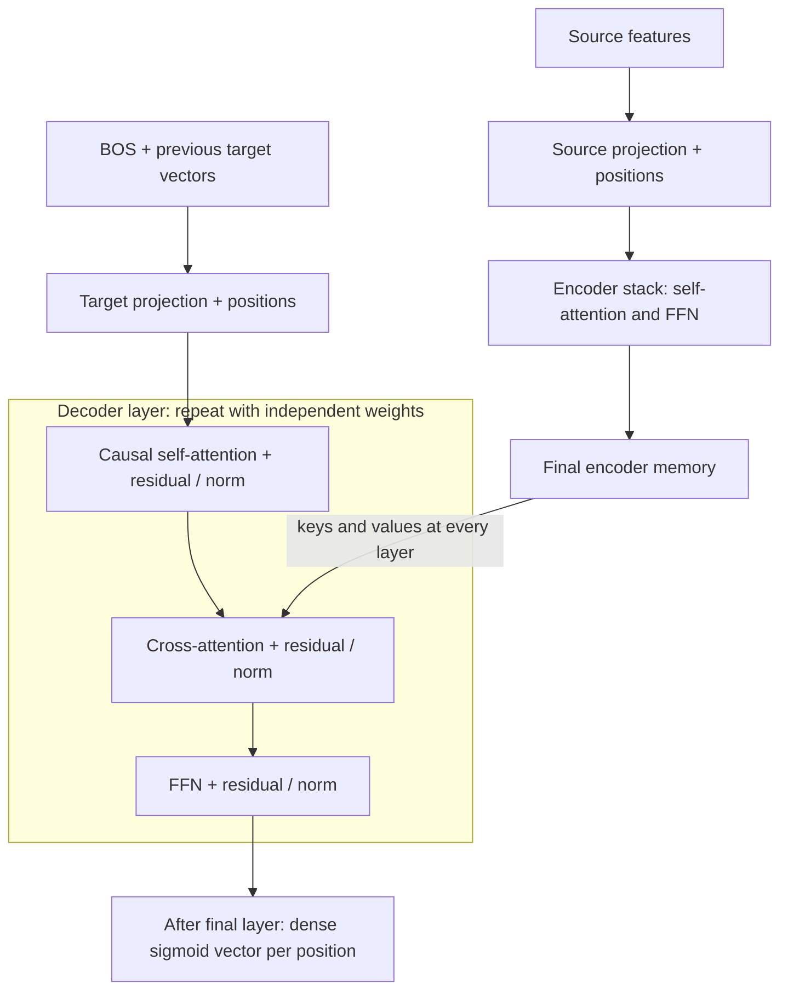

# Encoder-decoder Transformer for numerical sequences

## Computation diagram



Attention and FFN sublayers include residual addition and post-normalization. Training uses shifted true targets; generation feeds back continuous predictions. Padding masks exclude trailing padded keys and loss positions.

## How it works

An encoder-decoder maps a source sequence to an output sequence. The encoder produces one memory vector per source position. The decoder uses two kinds of attention: causal self-attention over its earlier inputs, and cross-attention whose keys/values come from encoder memory.

For each encoder/decoder block (repeat with independent parameters for the configured depth):

```text
source = ProjectSource(sourceFeatures) + positions
memory = EncoderBlock(source)                         bidirectional self-attention + FFN

decoder = ProjectTarget(shiftedTargetFeatures) + positions
D1 = LayerNorm(decoder + MultiHeadSelfAttention(decoder, causal=true))
D2 = LayerNorm(D1 + MultiHeadCrossAttention(Q=D1, K=memory, V=memory))
D3 = LayerNorm(D2 + FFN(D2))
output_t = sigmoid(OutputHead(D3_t))
```

Every attention stage splits full-width Q/K/V into `headCount` heads of width `modelSize/headCount`, scales scores by the square root of head width, concatenates contexts and applies a learned output projection. Each residual has its own learned layer normalization. FFNs use ReLU between two linear blocks. Source and target feature projections are independent; each sequence starts its own positional index at zero, and weights are shared across positions within a block.

Unlike the pooled [encoder classifier](transformer.md), this model returns an output vector at every target position. Source and target lengths may differ, and both may have multiple numerical features.

### Teacher forcing and the causal mask

During training, the caller shifts the target sequence **right by one position** and puts a beginning-of-sequence vector (BOS) first. For target `[y0, y1]`:

```text
decoder input: [BOS, y0]
training target: [y0, y1]
```

Query position `t` may attend only to decoder keys `0 … t`. For query zero, key one contains the answer `y0`, so it must be masked. The implementation excludes masked keys before softmax, giving them exactly zero weight. This prevents future target leakage when training all output positions together.

During generation, no true target sequence is supplied. The first input is BOS; each later decoder input is the preceding model prediction. The model recomputes the forward pass at every step and uses continuous sigmoid outputs as feedback, without rounding or sampling.

### Padding and the loss

Optional Boolean masks are indexed by position, not feature: **true means padding / ignore**. Each mask must match its configured sequence length and describe a nonempty valid prefix followed by a padding suffix. All-padding sequences and masks with holes are rejected. Null means every position is valid.

- Encoder and cross-attention exclude padded source keys.
- Decoder self-attention combines target key padding with the causal condition.
- Padded embeddings bypass feature projection; their feature values do not affect valid outputs. All supplied values must still be finite.
- Padded target output vectors are returned as zeros, and their loss terms are omitted.
- Inspection rows for padded queries remain normalized over visible keys; they are not meaningful predictions. Source-padding columns and future/padded decoder columns are exactly zero.

The objective is `½ Σ_valid_positions Σ_features (output-target)²`. It is summed, not divided by the number of valid positions. Longer valid targets therefore contribute more loss. Even ignored target entries must be finite and within `[0, 1]` so public input validation stays consistent.

## How it was programmed

[TransformerSequenceToSequence.cs](../../src/NeuralNetworks/TransformerSequenceToSequence.cs) composes configurable encoder and decoder stacks. [TransformerStacks.cs](../../src/NeuralNetworks/Internal/TransformerStacks.cs) iterates every layer and shares decoder causal self-attention, cross-attention and FFN computation with the token model. The decoder's cross-attention queries come from the normalized decoder state; its keys/values come from encoder outputs. All encoder and decoder layers participate in one loss graph. Every decoder cross-attention reads the final encoder layer output.

[MultiHeadAttention.cs](../../src/NeuralNetworks/Internal/MultiHeadAttention.cs) handles all three attention stages; [TransformerLayers.cs](../../src/NeuralNetworks/Internal/TransformerLayers.cs) shares embedding, residual, FFN and padding validation. The [training engine](../TRAINING.md) accepts per-call forward functions and output masks, avoiding mutable mask/context fields. Padding arrays are validated and copied per call. A failed training step never partially updates parameters.

Construction order is source projection, target projection, every encoder block, every decoder block, then the final head. Each encoder block stores Q/K/V/output projection, attention normalization, FFN input/output and FFN normalization. Each decoder block stores self Q/K/V/output and normalization, cross Q/K/V/output and normalization, then FFN input/output and normalization. Linear blocks store neuron weights followed by bias; normalization stores gamma then beta. Head count changes attention layout without adding parameter slots. Depth adds independent blocks and must accompany parameter snapshots.

## How to use it

The example reverses the four possible two-bit numerical inputs. Its BOS marker `0.5` is distinct from its binary data values:

```csharp
using NeuralNetworks;

var model = new TransformerSequenceToSequence(
    sourceLength: 2, targetLength: 2, inputSize: 1, outputSize: 1,
    modelSize: 4, headCount: 2, feedForwardSize: 8, seed: 42);
double[][] source = [[0, 0], [0, 1], [1, 0], [1, 1]];
double[][] target = [[0, 0], [1, 0], [0, 1], [1, 1]];
var shifted = target.Select(t => new[] { 0.5, t[0] }).ToArray();
for (var epoch = 0; epoch < 1500; epoch++)
    for (var i = 0; i < source.Length; i++)
        model.TrainSample(source[i], shifted[i], target[i], learningRate: 0.1);

var generated = model.Generate([0, 1], startToken: [0.5]); // approximately [1, 0]
var weights = model.GetAttentionWeights([0, 1], decoderInput: [0.5, 1]);
// weights.EncoderSelf[head][sourceQuery][sourceKey]
// weights.DecoderSelf[head][targetQuery][targetKey]
// weights.Cross[head][targetQuery][sourceKey]
```

Run these commands from the repository root:

```sh
dotnet build --configuration Release
dotnet run --project examples/Transformer --configuration Release --no-build -- all
# Or run only the encoder-decoder:
dotnet run --project examples/Transformer --configuration Release --no-build -- seq2seq
```

The executable trains, prints teacher-forced loss, then separately checks free-running generation against every reverse target. Its seeded mean sequence loss decreases from approximately `0.237203` to `0.000033`. This demonstrates learning on these four training sequences, not unseen-sequence generalization.

For shorter examples inside configured maximum lengths, use explicit masks:

```csharp
using NeuralNetworks;

var padded = new TransformerSequenceToSequence(3, 3, 1, 1, seed: 42);
bool[] sourcePadding = [false, false, true];
bool[] targetPadding = [false, false, true];
var output = padded.Predict(source: [0.2, 0.8, 999], decoderInput: [0.5, 0.8, 999],
    sourcePaddingMask: sourcePadding, targetPaddingMask: targetPadding);
var loss = padded.Loss([0.2, 0.8, 999], [0.5, 0.8, 999], [0.8, 0.2, 0],
    sourcePadding, targetPadding);
// output[2] is zero; the third target contributes no loss. This snippet does not train the model.
```

### API and shapes

`Predict`, `Loss`, `ComputeGradient` and `TrainSample` take source and decoder input separately, plus optional source/target padding masks. `Generate` takes source, one BOS vector and an optional source mask, and returns exactly `TargetLength` generated vectors. It has no target mask or EOS stopping rule.

Flatten both sequences in time-major order. `inputSize` means source features per position; `outputSize` means target features per position. Properties are `SourceLength`, `TargetLength`, `InputFeatures`, `OutputFeatures`, `SourceSize` and `TargetSize`. Source arrays have `SourceSize` entries; decoder inputs, targets and results have `TargetSize` entries; BOS has `OutputFeatures` entries.

The inherited `IGradientNetwork` interface remains available for unmasked samples: its flat input is `[all source features, all decoder-input features]`, `InputSize = SourceSize + TargetSize`, and `OutputSize = TargetSize`. Use the typed overloads for padding. The inherited flat API does not shift targets automatically. `GetParameters` and `SetParameters` operate on copied vectors; snapshots require the exact architecture, dimensions and head count.

## Validation and limitations

Tests check independently calculated head scores and concatenation, full parameter gradients, masked gradients, causal future independence, cross-attention dependence on source memory, padding invariance in predictions/loss/gradients, detached attention matrices, deterministic updates, invalid dimensions/masks/values and atomic overflow rejection. A learning test checks **autoregressive** reversal, not just teacher-forced predictions.

This numerical API supports configurable encoder/decoder stacks with sigmoid/MSE outputs. Optional `encoderLayerCount` and `decoderLayerCount` default to one, preserving earlier source calls and one-layer parameter ordering. For vocabulary embeddings, tokenization, categorical loss and EOS-based text generation, use [TextTransformer](transformer-text.md). This numerical class has no beam search, KV cache, dropout, batch optimization or pretrained weights. Source and target capacities are fixed at construction; padding accommodates shorter valid prefixes. Attention is quadratic in sequence lengths and the scalar tape is intentionally allocation-heavy. Use short sequences and small dimensions.

Further reading: [Attention Is All You Need](https://arxiv.org/abs/1706.03762), particularly the encoder/decoder, multi-head attention and shifted decoder input sections. This project implements those core interactions in a small numerical teaching model.

[Multi-head encoder guide](transformer.md) · [training engine](../TRAINING.md) · [documentation index](../README.md).

## Configuring multiple encoder and decoder layers

```csharp
using NeuralNetworks;

var stacked = new TransformerSequenceToSequence(2, 2, 1, 1, seed: 42,
    encoderLayerCount: 2, decoderLayerCount: 2);
var output = stacked.Predict([0.2, 0.7], [0.5, 0.3]);
var layers = stacked.GetLayerAttentionWeights([0.2, 0.7], [0.5, 0.3]);
// layers.DecoderSelf[layer][head][query][key]
```

Each layer uses independent Q/K/V, output, FFN and normalization parameters. `GetAttentionWeights` retains its three-dimensional snapshots by selecting encoder/decoder layer zero by default; optional `encoderLayerIndex` and `decoderLayerIndex` select others. `GetLayerAttentionWeights` returns all layers. Numeric padding and causal rules apply in every layer. For actual text generation with a two-layer stack, see [the token guide](transformer-text.md).
