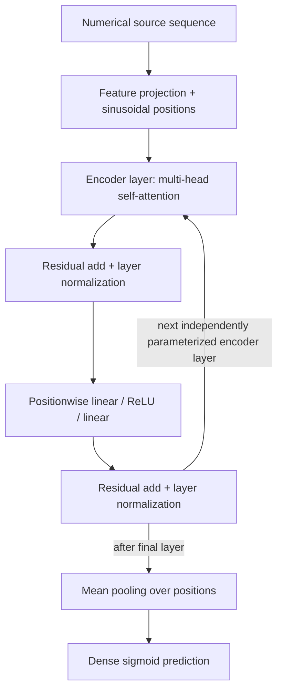

# Multi-head Transformer encoder

## Computation diagram



The loop means a finite stack, not recurrence with shared parameters. Every encoder position can attend to every source position. Both residual paths add each sublayer input before normalization.

## How it works

Self-attention lets each position combine information from every position in a numerical sequence. Multiple heads learn separate query/key/value subspaces before their contexts are concatenated. For model width `d` and head count `h`, this implementation uses `headSize = d/h`:

```text
X = numerical input projection + sinusoidal positions
Q = X W_Q + b_Q; K = X W_K + b_K; V = X W_V + b_V
head_i = softmax(Q_i K_iᵀ / sqrt(headSize)) V_i
attention = Concat(head_0, …, head_(h-1)) W_O + b_O
H = LayerNorm(X + attention)
Z = LayerNorm(H + FFN(H))
prediction = sigmoid(OutputHead(mean_over_positions(Z)))
```

Each head uses its own contiguous coordinates of the full-width Q/K/V projections. These projection rows are independent learned parameters. The softmax is separate for each query and head. Concatenation preserves each head's coordinates; heads are not averaged. Changing the head count changes how those coordinates interact, even though the number of projection parameters stays the same.

The positionwise FFN is linear → ReLU → linear. Layer normalization uses learned gamma/beta and epsilon `1e-5`, after each residual addition. The encoder is bidirectional: every source position can attend to all source positions. Its configurable stack repeats this computation with independent parameters in every layer; the final layer is pooled for prediction.

## How it was programmed

[TransformerEncoder.cs](../../src/NeuralNetworks/TransformerEncoder.cs) allocates projections and an encoder layer. Shared [MultiHeadAttention.cs](../../src/NeuralNetworks/Internal/MultiHeadAttention.cs) projects Q/K/V, splits their coordinates into heads, computes scaled scores and stable softmax rows, concatenates contexts and applies the output projection. [TransformerLayers.cs](../../src/NeuralNetworks/Internal/TransformerLayers.cs) contains positional embedding, residual and FFN operations also used by the encoder-decoder.

Softmax subtracts the largest visible score before exponentiation. This common numerical shift leaves normalized probabilities unchanged. The [reverse-mode tape](../TRAINING.md) accumulates gradients through every head and projection. Head count must be positive and divide `modelSize`, which must be at least two.

`GetMultiHeadAttentionWeights(input)` returns detached arrays indexed `[head][query][key]`. `GetAttentionWeights(input, headIndex: 1)` selects one head; omitting `headIndex` selects head zero, not an average of the heads.

## How to use it

```csharp
using NeuralNetworks;

var model = new TransformerEncoder(sequenceLength: 2, inputSize: 1,
    modelSize: 4, outputSize: 1, feedForwardSize: 4, seed: 42, headCount: 2);
double[][] sequences = [[0, 0], [1, 1]];
double[][] targets = [[0], [1]];
for (var epoch = 0; epoch < 1200; epoch++)
    for (var i = 0; i < sequences.Length; i++)
        model.TrainSample(sequences[i], targets[i], 0.5);
var output = model.Predict([1, 1]);
var attention = model.GetMultiHeadAttentionWeights([0, 1]);
```

Run `dotnet run --project examples/Transformer -- encoder`. The two-head numerical intensity example lowers mean loss from approximately `0.129052` to `0.000021`, verifies predictions and prints separate attention rows. The old architecture tour retains its single-head baseline.

Inputs remain finite, flat, time-major numerical features, with length `sequenceLength * inputSize`. Targets have `outputSize` entries in `[0, 1]`. The constructor appends optional `headCount = 1` after `seed`, preserving existing source calls, initialization and parameter ordering for the single-head model.

## Validation and limitations

Tests cover independently calculated per-head scores, scaling by `sqrt(headSize)`, concatenated-context output, every parameter's numerical gradient, head validation, detached snapshots, deterministic training and the original single-head regression cases.

This class is a configurable encoder stack with a pooled prediction head. Optional `layerCount` defaults to one; `LayerCount` reports the depth. `GetLayerAttentionWeights(input)` returns `[layer][head][query][key]`; existing head inspection methods accept an optional `layerIndex` defaulting to zero. For causal decoding, source/target padding, teacher forcing and generation, use [TransformerSequenceToSequence](transformer-seq2seq.md). The standalone pooled encoder API processes every input position; it does not take a padding mask.

This numerical class has no dropout, pretrained weights or tokenization. For learned token embeddings, categorical loss and generated text, use [TextTransformer](transformer-text.md). Optimized tensor kernels are not implemented. Numerical outputs use sigmoid and squared error. Attention remains quadratic in sequence length, and scalar tapes are suitable only for small examples. Saving parameters requires also retaining dimensions, layer count and head count; a vector does not encode its attention layout.

Further reading: [Attention Is All You Need](https://arxiv.org/abs/1706.03762). The implementation follows the multi-head encoder computation with a small numerical prediction head.

Next: [encoder-decoder Transformer](transformer-seq2seq.md) · [all architecture guides](../README.md).

## Configuring multiple encoder layers

```csharp
using NeuralNetworks;

var stacked = new TransformerEncoder(2, 1, 4, 1, seed: 42, headCount: 2, layerCount: 2);
var output = stacked.Predict([0.2, 0.7]);
var attention = stacked.GetLayerAttentionWeights([0.2, 0.7]);
```

The first layer retains the original parameter ordering, including the pooled head's legacy slot; additional encoder blocks are appended after it. Extra blocks use Q/K/V/output, attention normalization, FFN input/output and FFN normalization order. Existing one-layer source calls and snapshots keep their behavior. See the [text example](transformer-text.md) for a trained two-encoder/two-decoder stack.
